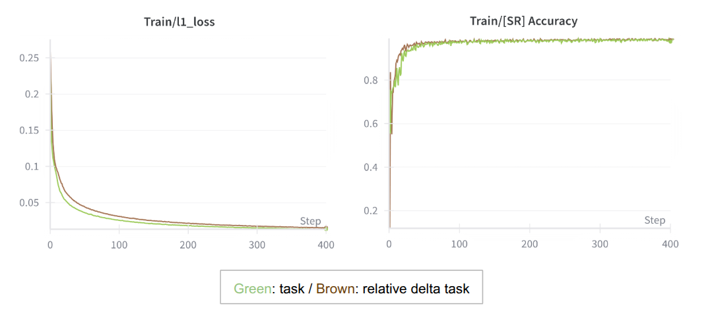

# Training
The `train` directory contains the necessary code to train policies with imitation learning.

## Training configurations
The codebase supports the following configurations.

(1) Algorithm
- ACT (i.e., Action Chunking Transformer) [[Paper](https://arxiv.org/abs/2304.13705)]

(2) Robot mode
- Single robot arm
- Single robot arm with gripper
- Dual robot arm
- Dual robot arm with gripper

(3) Control mode (i.e., output of neural network)
- Task space
- Relative delta task space [[Paper](https://arxiv.org/abs/2402.10329)]

Configurations can be controlled via *yaml* files listed below `config`. 

To create your own config, create a new directory under `config`, and copy one of the existing *yaml* files under `config/fake_data_example` or `config/real_data_example` as a template. You can then adjust parameters such as `task_name`, `batch_size`, or `lr`.

If you want to use RGB images as input, you can also crop the image by setting `extra.image_crop.[observation_name]` to `[[x_min, x_max], [y_min, y_max]]`. Refer to `config/fake_data_example/single_robot_task.yaml` for an example. You can experiment with different crop areas using the notebook in `deploy/helper/notebook/data_example.ipynb`.

## Usage
The collected data should first be placed under `data` as follows.
```
|- data
|---TASK_NAME
|----- 0.h5
|----- 1.h5
|---- ...
```
Then, follow these **three** steps:

1. Activate conda environment.
```
conda activate env_il
```
2. Preprocess the data. The preprocessed files will be saved under `processed_data`.
```
python preprocess.py --task TASK_NAME
```
3. Train the neural networks.
```
python imitate.py --config-path=config/CONFIG_DIRECTORY --config-name=CONFIG_FILE
```

## Usage examples
We provide a pipeline with randomly generated data to help users understand the process and required data format.

Before running the pipeline, ensure your SSD has at least 1GB of free space.

First, create and preprocess synthetic data. This will generate four datasets (*test_single_robot*, *test_single_robot_gripper*, *test_dual_robot*, *test_dual_robot_gripper*) under `data` and `processed_data`.
```
bash unit_test/make_fake_data.sh
```
Then, train neural networks with example configurations.
```
# Example 1: Single robot + Task space action
python imitate.py --config-path=config/fake_data_example --config-name=single_robot_task.yaml 

# Example 2: Single robot + Relative delta task space action
python imitate.py --config-path=config/fake_data_example --config-name=single_robot_relative_delta.yaml

# Example 3: Single robot with gripper + Task space action
python imitate.py --config-path=config/fake_data_example --config-name=single_robot_gripper_task.yaml

# Example 4: Single robot with gripper + Relative delta task space action
python imitate.py --config-path=config/fake_data_example --config-name=single_robot_gripper_relative_delta.yaml

# Example 5: Dual robot + Task space action
python imitate.py --config-path=config/fake_data_example --config-name=dual_robot_task.yaml

# Example 6: Dual robot + Relative delta task space action
python imitate.py --config-path=config/fake_data_example --config-name=dual_robot_relative_delta.yaml

# Example 7: Dual robot with gripper + Task space action
python imitate.py --config-path=config/fake_data_example --config-name=dual_robot_gripper_task.yaml

# Example 8: Dual robot with gripper + Relative delta task space action
python imitate.py --config-path=config/fake_data_example --config-name=dual_robot_gripper_relative_delta.yaml 
```

We also provide configuration files for training imitation policies with real-world data in `config/real_data_example`.

## Real data examples
Compatible real-world data are located in unit_test/example/data, with corresponding visualizations in unit_test/example/data_viz.

## Joint-command models from a shared dataset

Use the `pace` environment and the sibling `pace-sim2real` checkout. Generate and
normalize once, then select the inputs, outputs, and architecture in a training YAML:

```bash
conda activate pace
cd ~/neuromeka-il/train
export OMP_NUM_THREADS=1

# Run these two stages once for the recordings (output directories must be empty).
bash run_correction.sh generate
bash run_correction.sh preprocess --validation-fraction 0

# Train separate experiments on the SAME processed data.
bash run_correction.sh train --run eir_qv_run1 \
  --train-config config/correction/eir_position_velocity.yaml --device cuda:0
bash run_correction.sh train --run eir_direct_run1 \
  --train-config config/correction/eir_direct.yaml --device cuda:0
```

The default directories are:

- Raw: `../pace-sim2real/genesis_bridge/logs/teleop_residual/teleop_common`
  relative to the checkout root.
- Processed: `train/processed_data/teleop_common`.
- Weights: `train/weights/<run>`.

`--run` selects only the checkpoint directory; generation/preprocessing now use
common directories independently of the run name. Override `--raw-dir` and
`--processed-dir` for another dataset, including existing per-run datasets.
Use `all` only when both data directories are new/empty. All recordings are used
for training by default; `--validation-fraction 0.5` holds out one of the two EIR
recordings. The split is shared across experiments. Statistics use training
recordings only. Append `--epochs 1000` to override the YAML or `--wandb` to enable
logging; project/entity/mode are in `train.wandb`. `--dry-run` prints commands.

For recordings with likely gaps between rows, the wrapper can run
[`repair_recording_timing.py`](../../pace-sim2real/genesis_bridge/repair_recording_timing.py)
before generating labels. It checks `qdes/qdotdes` and measured `q/qdot` jointly,
inserts inferred samples on the existing uniform grid, and preserves all original
samples. The repaired H5 can also be passed directly to `replay.py` or
`replay_teleop.py`. Timing is inferred; separate teleop glitches can remain.

```bash
# Run from neuromeka-il/train; each output directory must be new/empty.
bash run_correction.sh generate --repair-timing \
  --repaired-dir ../../pace-sim2real/genesis_bridge/logs/timing_repaired/nami_joint_abs \
  --raw-dir ../../pace-sim2real/genesis_bridge/logs/teleop_residual/eir_repaired
bash run_correction.sh preprocess \
  --raw-dir ../../pace-sim2real/genesis_bridge/logs/teleop_residual/eir_repaired \
  --processed-dir processed_data/eir_repaired
bash run_correction.sh train --run eir_repaired \
  --processed-dir processed_data/eir_repaired \
  --train-config config/correction/eir_nominal_acceleration.yaml
```

Use `bash run_correction.sh repair --repaired-dir PATH` to produce repaired H5
only. For existing repaired files, use `generate --data PATH` without
`--repair-timing`. `all --repair-timing` chains repair, generation, preprocessing,
and training. Inspect `timing_repair_summary.json` and each H5's `.timing.json`
report for accepted/rejected gaps, estimated durations and remaining teleop jumps.

The wrapper preprocesses with `--all-fields`; the equivalent Python command is:

```bash
python preprocess_correction.py \
  --input ../PATH/TO/teleop_common --output processed_data/teleop_common \
  --all-fields --validation-fraction 0
```

Every raw H5 contains 32 aligned `[T,18]` arrays. `T` is the number of physics
transitions, with the final current-state sample omitted. The common normalized
H5 retains all 32 fields as `[T,14]` by default (active EIR arms). Only per-field,
per-joint mean/std normalization is applied; there are no image or pose transforms.
The trainer reads only the fields selected by its YAML and copies the selected
normalization statistics into the weight directory. Changing model features does
not require preprocessing again. Older selected-field datasets remain readable.

| Config | `control_mode` | Default input tokens | Outputs |
| --- | --- | --- | --- |
| `eir.yaml` | `acceleration_correction` | `answer_q`, `answer_v`, `nominal_on_answer` | `correction` |
| `eir_position.yaml` | `position_correction` | `answer_q`, `answer_v`, `teleop_error` | `position_correction` |
| `eir_position_velocity.yaml` | `position_velocity_correction` | `reference_q`, `reference_v`, `reference_teleop_error` | `delta_q`, `delta_v` |
| `eir_nominal_command.yaml` | `nominal_command` | `nominal_q`, `nominal_v`, `nominal_teleop_error` | `command_delta_q`, `command_delta_v` |
| `eir_nominal_acceleration.yaml` | `nominal_acceleration_command` | `nominal_q`, `nominal_v`, `nominal_teleop_error` | `command_delta_acc` |
| `eir_direct.yaml` | `direct_command` | `robot_q`, `robot_v`, `robot_teleop_error` | `qdes_minus_teleop`, `qdotdes` |

Prefix input names with `observation.` and output names with `action.` in YAML.
Each `state_token_keys` entry gets a separate transformer token. Match its entry
in `input_shapes` and specify `output_shapes` in the desired output order. All
features are 14-dimensional for the current EIR active-joint selection. The three two-output
configurations produce `[B,2,28]` chunks and execute one step per query by
default (`chunk_size: 2`, `n_action_steps: 1`). Inputs can be subset/reordered within
a mode; `teleop_target` is also available. Virtual q/v mode additionally supports
`nominal_on_reference`. Output sets must match the selected `control_mode`, which
defines the inference mechanism. Unsupported combinations fail explicitly.

`answer_q/v` retain the legacy reconstruction, enforcing semi-implicit integration.
`reference_q/v` independently interpolate recorded qdes/qdotdes linearly to 5 ms,
preserving recorded endpoints without forcing velocity to explain position jumps.
`robot_q/v` independently interpolate recorded measured encoder q/qdot for labels.
Teleop is causally held until the next recorded command.

For `position_velocity_correction`, row k labels a transition:

```python
v_nom_next = reference_v[k] + dt * PD(teleop[k], reference_q[k], reference_v[k])
q_nom_next = reference_q[k] + dt * v_nom_next
delta_q = reference_q[k+1] - q_nom_next
delta_v = reference_v[k+1] - v_nom_next
```

At runtime the same calculation uses its own corrected virtual q/v. Both outputs
are added independently to the nominal next state and fed back. It does not derive
velocity from position. Interpolation is a reference assumption; it does not
recover unrecorded physical states or guarantee consistency between q/v.

For `nominal_command`, run the full nominal PD trajectory without correction,
initialized once from `reference_q[0]` and `reference_v[0]`. Export:

```python
nominal_q[k], nominal_v[k]  # Independent zero-correction rollout states
nominal_teleop_error[k] = teleop[k] - nominal_q[k]
command_delta_q[k] = reference_q[k] - nominal_q[k+1]
command_delta_v[k] = reference_v[k] - nominal_v[k+1]
```

Row k contains pre-integration inputs and labels correcting the integrated
nominal state to the reference command at k. The first residual can be nonzero.
They differ from `delta_q/delta_v`, which start a nominal step at reference k and
target reference k+1. Inference uses only pre-integration nominal q/v and
teleop-minus-nominal-q:

```python
dq, dv = network(nominal_q, nominal_v, teleop - nominal_q)
# Integrate the independent nominal state before forming this tick's command.
a_pd = PD(teleop, nominal_q, nominal_v)
nominal_v = nominal_v + dt * a_pd
nominal_q = nominal_q + dt * nominal_v
qdes, qdotdes = nominal_q + dq, nominal_v + dv  # Command at timestamp k.
```

The commanded q/v never overwrite the nominal state. Changing network predictions
therefore cannot change later nominal inputs. Resetting an episode resets both the
nominal state and ACT queue. Inference initialization, gains, timestep, and teleop
sampling must match label generation. The model predicts command residuals; low
command error does not by itself guarantee physical tracking performance.

```bash
bash run_correction.sh train --run eir_nominal_run1 \
  --train-config config/correction/eir_nominal_command.yaml --device cuda:0
```

Use `--weights ../neuromeka-il/train/weights/eir_nominal_run1` in replay; the saved
`control_mode` selects this mechanism automatically. `--prepare-only` evaluates
these commands on the independent nominal rollout without Genesis.
The raw/processed data and selected checkpoint normalization metadata carry
`nominal_command_timing: post_integration`. Earlier nominal-command data use
pre-integration command baselines: regenerate/preprocess them (or use the updated
shared dataset), then retrain in a new weight directory. Training and replay reject
old nominal-command timing to avoid mixing label conventions. The other model
fields and their semantics are unchanged.

For `nominal_acceleration_command`, use `eir_nominal_acceleration.yaml`. The
same three nominal-state tokens predict one 14D output:

```python
command_delta_acc[k] = command_delta_q[k] / dt**2
# command_delta_q[k] = reference_q[k] - nominal_q[k+1]
```

This position-matching label is normalized once along with the other common
fields. At replay, decode delta_acc in acceleration units and form
`q_cmd = nominal_q_next + dt**2 * delta_acc` and
`v_cmd = nominal_v_next + dt * delta_acc`. Nominal PD always integrates without
neural correction; neither command overwrites its state. The motor uses ordinary
q/v PD. The saved mode automatically selects this inference mechanism.

An exact label prediction matches reference qdes. It generally does not match the
independently interpolated vdes, since one output forces `delta_q = dt * delta_v`.
This label represents a position residual in acceleration units rather than a
finite difference of recorded velocity. Checkpoint normalization metadata records
`command_delta_acc_target: position` and `nominal_command_timing: post_integration`.
The defaults produce `[B,2,14]` chunks with `n_action_steps: 1`.

```bash
bash run_correction.sh train --run eir_nominal_acc_run1 \
  --train-config config/correction/eir_nominal_acceleration.yaml \
  --processed-dir processed_data/teleop_common --device cuda:0
```

For `direct_command`, labels and inputs share timestamp k:

```python
inputs = (robot_q[k], robot_v[k], teleop[k] - robot_q[k])
outputs = (reference_q[k] - teleop[k], reference_v[k])
# Runtime:
qdes = teleop + predicted_qdes_minus_teleop
qdotdes = predicted_qdotdes
```

Replay reads the current simulated robot q/v (encoder coordinates), computes
these commands before stepping physics, and does not run virtual semi-implicit
PD. The physical robot's PD tracking controller still tracks qdes/qdotdes.
Recorded robot states are used for evaluation references, not live policy inputs.

```bash
cd ~/pace-sim2real
python genesis_bridge/replay_teleop.py \
  --config genesis_bridge/configs/eir_train.yaml \
  --data ~/Desktop/pace_eir_data/data/nami_joint_abs \
  --correction neural --weights ../neuromeka-il/train/weights/eir_direct_run1 \
  --show-qdes
```

Use the other experiment's weight directory to change mechanisms. Replay loads
`control_mode`, token/output keys, chunk size, and execution length from the saved
`config.yaml`. It also loads `normalization.json` and `best.pt`. Use `--checkpoint
last.pt` for the final checkpoint, `--headless` for physics without a viewer.
Neural replay saves no output files. For direct models, `--prepare-only` evaluates
commands on recorded robot states and explicitly reports teacher-forced metrics;
it is not a closed-loop simulation. For virtual modes it runs a virtual rollout.

The existing virtual recovery fine-tuner supports acceleration and position-only
models. The other modes need a different recovery teacher and are rejected by
that fine-tuner. Use this supervised trainer for these experiments.

## Training plot examples
[Wandb](https://wandb.ai/site/) can be enabled in the configuration file (`logging: True`) to visualize training progress. Below is an example training result for a single robot arm task:



